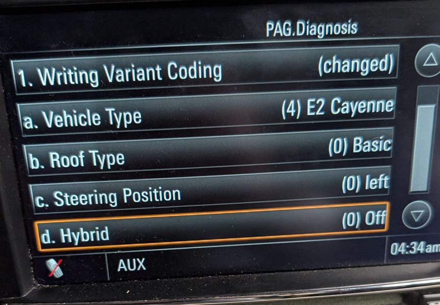

# Fitting a used PCM 3.1 from another car

A used PCM keeps two things from the car it came out of:

- the donor car's VIN, which every activation code is checked against;
- the donor car's variant coding: model, roof, steering side and hybrid type.

This guide gets both right using only PCM-Forge and the PCM's own screen. You don't need a dealer
tester.

| Step | What | Why |
|---|---|---|
| 1 | Run Diagnostic Mode and read the donor VIN | Codes must match the VIN stored in the PCM |
| 2 | Activate with the donor VIN and **your** car's model | Features, boot logo and the engineering menu |
| 3 | Check the variant coding in the engineering menu | Hybrid screens, steering side, model |
| 4 | Check the result | — |

## 1. Read the donor VIN

On the **USB Stick** tab, tick **Diagnostic mode**, build the stick and run it on the PCM. It's
read-only. The VIN the PCM has stored is on the returned stick, in two places:

- `pcm_dump_<date>/vin`
- `pcm_debug_<date>.log`, under `=== VIN ===`

The **Backup** tab (or **Open returned stick…** in the offline app) reads that stick for you. It
shows the stored VIN and the features the PCM already has.

## 2. Activate with the donor VIN

Build an activation stick with:

- the **donor VIN** from step 1, not your car's VIN;
- **your car's model**. That sets the boot logo and the model identity. A hybrid gets the hybrid
  logo, for example *Cayenne S E-Hybrid*.
- **ENGINEERING** ticked, because step 3 needs the engineering menu.

Run it and restart the PCM when the stick says it's done. The README's
[Replacement / Used PCMs](../README.md#replacement--used-pcms) section explains why the donor VIN is
the recommended route.

## 3. Match the variant coding

Press **SOURCE + OPTION** to open the engineering menu, then open **PAG.Diagnosis**. It shows the
PCM's variant coding:

| Field | Set it to |
|---|---|
| a. Vehicle Type | your car's platform, e.g. **(4) E2 Cayenne** |
| b. Roof Type | leave as it is, unless you know your car needs another value |
| c. Steering Position | **(0) left** or **(1) right**, matching your car |
| d. Hybrid | see the table below |

To change a field:

1. Select the field and choose the new value. The top entry then shows **(changed)**.
2. Select **1. Writing Variant Coding**. It answers **ok**.

The change takes effect straight away, with no restart, and it stays after the PCM is powered off.

### Hybrid

| Value | Meaning | Car |
|---|---|---|
| 0 Off | not a hybrid | every non-hybrid car |
| 1 Two Wheel | full hybrid, rear-wheel drive | Panamera S Hybrid *(expected, not tested)* |
| 2 Four Wheel | full hybrid, all-wheel drive | **Cayenne S Hybrid 2011–2014** *(tested)* |
| 3 Plugin Two Wheel | plug-in, rear-wheel drive | Panamera S E-Hybrid *(expected, not tested)* |
| 4 Plugin Four Wheel | plug-in, all-wheel drive | Cayenne S E-Hybrid 2015–2018 *(expected, not tested)* |

What the hybrid setting changes:

- **Off → Four Wheel** adds two pages at the start of the CAR menu: **Hybrid energy flow** and
  **Engine-off Mode**.
- The **plug-in values** should also add the E-range and charging pages.
- The data on these pages comes from the car's hybrid modules over CAN. On a bench, or in a car
  without them, the pages show up empty.

**The values a PCM accepts depend on its software.** The 958.1-era PCM we tested (2011–2014
software) accepted up to **2** and refused **4**, the plug-in value. A donor from an older car going
into a plug-in hybrid will probably need a newer PCM software before it accepts **4**.

### What's tested and what isn't

- **Tested, on a 958.1 Cayenne PCM on the bench:**
  - Hybrid Off → Four Wheel and back, both over diagnostics and from this menu;
  - nothing else in the PCM's coding changed;
  - the value survived a power cycle.
- **Not tested yet:**
  - the plug-in values on 958.2 software;
  - the Steering Position and Vehicle Type fields;
  - Panamera units.

Reports are welcome; open an issue.

## 4. Check

- The boot logo matches your car.
- **SOURCE + OPTION** opens the engineering menu, which shows the activation worked.
- A hybrid shows the hybrid pages in the **CAR** menu, filled in once the car is running.

## Notes

- `/HBpersistence/hybrid.bin`, which you may see on a Diagnostic Mode stick, is only the trip
  computer's saved hybrid history. A swapped PCM starts its own; there is nothing to copy.
- Other coding (AUX input, sound system, units, tuner region, and so on) is outside this menu and
  still needs a diagnostic tester.
